{/*
  PLACEHOLDER DRAFT, written by Claude in Gianluca's voice. Rewrite freely.
  - hidden: true keeps it out of listings/feed/sitemap; reachable at /home-styling-rabbit-hole.
  - [TK: …] = facts only you know. Comment notes like this one don't render.
  - Reality has been bent a little on purpose, as requested (the "accidental" outside, the stairs dialogue).
  - New component: <ApartmentPipeline/> (components/mdx/ApartmentPipeline.tsx). Click a node to pause on it.
  - New images in this folder: bed_top.jpg, table.gif, morning.jpg, nightsky.jpg, hood.jpg, hue.jpg, desk.jpg.
*/}

After five years of commuting to another country every single day, I'm finally moving.

{/* Callback: /germany ("Leaving Germany") and /working-from-the-office. Keep one or both. */}

Not to a new country, mind you. To the country I've been commuting *to*. If you are a long-time reader you know I [don't move countries lightly](/germany), and you also know how I feel about [working from the office](/working-from-the-office). Combine the two and you get five years of trains over the Øresund bridge, [TK: number] delays, and a very personal relationship with the [TK: your train] from Lund.

Moving gives me back two hours a day.

Two hours! Which is great, because lately my evenings have the energy of a phone at 3%. I get home, I collapse on the sofa, I eat mayonnaise. Not *with* something. Just mayonnaise.

{/* Keep or kill the mayonnaise. It's your line. */}

Leaving Sweden comes at a price, of course. Here is what I lose, in increasing order of severity:

* A local Amazon.
* Soft, delicious drinking water. Danish tap water is so hard you could build a [Neapolitan pizza oven](/pizza) out of the limescale it leaves in my [espresso machine](/9barista).
* Trees. Sweden is basically a forest with some IKEAs in it. Copenhagen is a beautiful city that has heard of trees.

And here is what I gain:

* Living with my soulmate. {/* TK: name her? memory says Svetlana. Or keep "my girlfriend" throughout. */}

That's it. That's the list. It's a short list, but it wins. 🥺

We bought an apartment in Sluseholmen. Sluseholmen is a cluster of artificial islands with canals, in the south harbour of Copenhagen. Please don't confuse it with Sydhavn. People in Sluseholmen do not like being confused with the Sydhavn population, or so I hear.

{/*
  FLAG: you said "Sydholm". I think you mean Sydhavn (Sydhavnen). Fun fact that makes the joke better:
  Sluseholmen is technically *part of* Sydhavn. Option: "...Please don't confuse it with Sydhavn. Technically it IS Sydhavn,
  but people in Sluseholmen don't like being reminded of that, or so I hear."
*/}

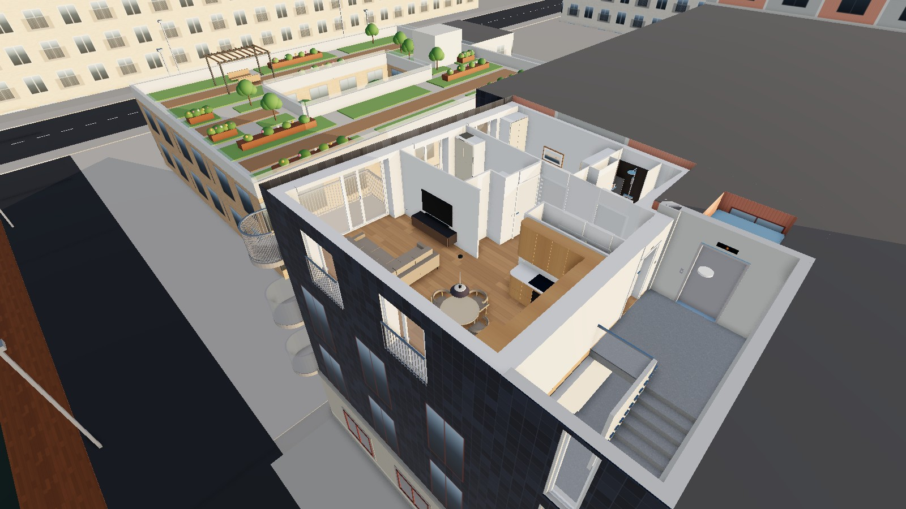

<FigureLabel>Our future home, seen from the point of view of God, or of a drone with no respect for privacy.</FigureLabel>

## The bed problem

You'd think the first problem when moving in together is whose sofa wins. It isn't. The first problem is the bedroom.

The bedroom is not small. It's *cozy*. Specifically, it's cozy in the space between the bed and the closets, which is where your shins live at 3 AM when you get up to pee.

So the question was: can we dare a 180 cm bed, or do we have to settle for a 160?

<Poll id="rabbit-hole-bed"
      question="180 or 160?"
      answers={[
          "180. You only live once, and you only have two shins.",
          "160. Love is about being close. Like, really close. Like, closet close.",
          "Sleep on the sofa with the mayonnaise.",
      ]}
      labels={["Brave", "Romantic", "Already living your life"]}
/>

My first attempt was the analog one. I took a sheet of squared paper, decided each square was 20 cm, and drew the bedroom to scale. Then I cut out my closet, her closet and the bed, and started moving them around like a general planning the invasion of Normandy.

{/* TK: photo of the squared paper, if it still exists. Even a bad phone photo works: */}
{/*  <FigureLabel>Exhibit A. Each square is 20 cm. Each eraser mark is a broken dream.</FigureLabel> */}

It took forever. And while I was erasing the bed for the fourth time, it hit me: I was doing exactly what my ancestors, the ancient Romans, did decades ago. Minus the slavery.

{/*
  FLAG: "decades ago" — intentional understatement? It's ~1,800 years. Real hook if you want it:
  the Forma Urbis Romae, a marble map of the whole of Rome carved around 203–211 AD at roughly 1:240,
  down to the individual rooms. Option: "...did eighteen centuries ago, minus the marble and the slavery."
*/}

Surely, I thought, something has been invented since then. Something from, say, the last twelve months. Something to do with my day job.

So I took the floor plan, a dozen photos of the apartment, and I fed them to Claude. And I asked it to solve the bed problem for me.

## Blender first

The plan was simple. Claude would build the apartment in Blender, the 3D software, and give me an isometric view, like the base in XCOM. Then I could swap beds and closets around and see what fits.

I have never opened Blender in my life. I still haven't. Claude drove it entirely through Python scripts, which is the kind of sentence that would have made 2019 me spit out my coffee.

<FigureLabel>XCOM: Enemy Unknown, but the enemy is a wardrobe.</FigureLabel>

It worked. Like, annoyingly well. The walls were in the right place, the doors opened the right way, the closets had real IKEA sizes.

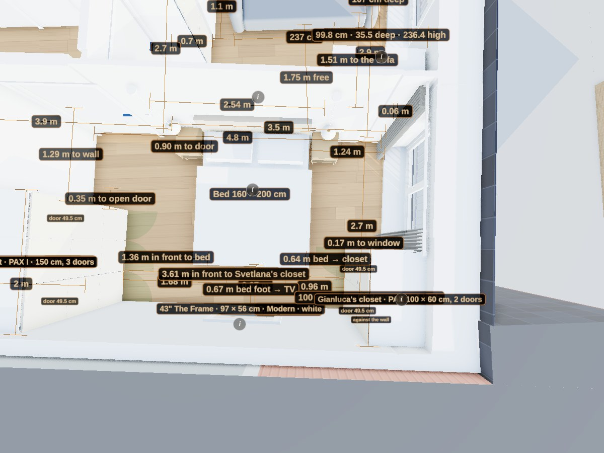

<FigureLabel>The digital version of my squared paper. 64 cm between the bed and the closet. My shins have been notified.</FigureLabel>

{/* Reality check: in the model the current bed is 160 × 200 with 0.64 m to the closet. TK: what did you decide, 160 or 180? Ending the section on the answer is the punchline. */}

[TK: verdict. 160 or 180?]

It went so smoothly that I got suspicious. Where is the catch? At what point does the AI stop serving me and start serving me garbage?

So I decided to push.

<Dialogue>Can I walk inside the apartment, with WASD, like in a videogame?</Dialogue>

Turns out, yes. Relatively easily. One afternoon later I was walking around my future living room in a browser, bumping into my future sofa.

## The pipeline

Here is how the sausage is made. It sounds complicated, and it is, but none of the complicated parts are done by me.

<ApartmentPipeline/>

1 - **Floor plan.** The realtor's floor plan plus my photos. Claude reads the walls off the image and turns them into numbers.

2 - **Blender, via Python.** A script called `build.py` uses `bpy`, Blender's Python API, to extrude the walls, cut the doors and windows and place the furniture. Blender runs headless. Nobody ever looks at it. Poor Blender.

3 - **GLB export.** The scene is merged and exported as a single GLB file, the JPEG of 3D models.

4 - **three.js viewer.** A web page with three.js loads the GLB and adds everything that moves: walking, lights, doors, time of day. Then everything gets squashed into one single HTML file.

5 - **Commit and push to GitHub.** Why put it on the web at all? Because I need direct feedback from my girlfriend, and she's not going to install Blender. She has a life.

6 - **Netlify builds this very blog**, a Next.js site you know way too much about if you read the [migration post](/migration). The apartment lives at [/apartment](/apartment).

7 - **Girlfriend review.** She opens the link on her phone, she walks around, she looks at the sofa for a long time, and then she says:

<Dialogue>I hate this.</Dialogue>

Back to square one.

<LinkButton to={"/apartment"} onHover={"🚪🚶‍♂️"}>Walk around the apartment yourself</LinkButton>

## The showroom phase

Once the bedroom was solved, the rest of the apartment looked at me with big puppy eyes. The kitchen. The living room. The small room that will become my office, which in Danish is a *værelse*, which in Danish also means "room", because Danes ran out of words after inventing *hygge*.

So I asked Claude to scout the web for sofas, tables and chairs. Real ones, that you can actually buy in Denmark, with links, prices and every available size and colour.

It came back with spec sheets. It read the product pages, the PDFs, the tiny grey text under the photos. It knew the Besalu table from ILVA has a 105 cm round top that pulls apart for a 60 cm leaf. It knew the Kasami chair is 48 by 54.5 cm. It knew the price before the discount and after the discount. It knew more about Danish furniture than most Danes.

Every piece goes into the model with its real size, so you can see if it fits. Then you can swap it.

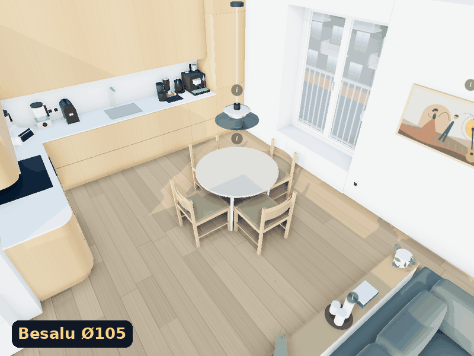

<FigureLabel>Ten dining tables in ten seconds. In real life this takes three Saturdays and one breakup.</FigureLabel>

{/* GIF: Besalu Ø105 → +leaf → Ø130 → +1 leaf → +2 leaves (228 cm, seats 9: we don't know 9 people) → white finish → Homitis Viona Ø100 → extended, Kasami chairs natural ↔ espresso oak. */}

The sofa took longer. [TK: how many sofas did you try before the ILVA Nyland? Memory says the Nyland corner sofa in Austin 13 Winter Moss won.]

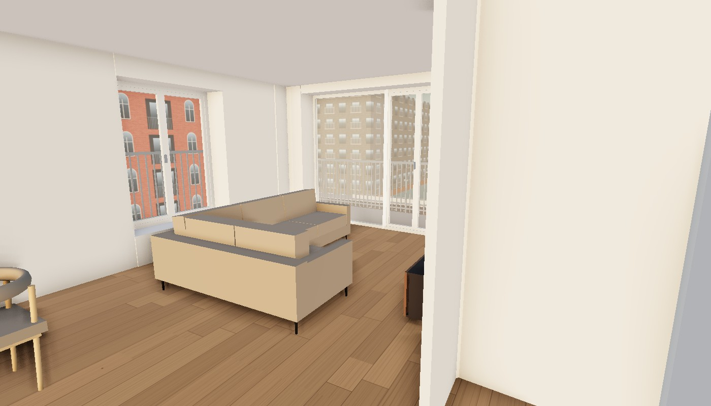

<FigureLabel>The living room, with one of the many sofas on trial. This one did not survive the review step.</FigureLabel>

## The outside (a small accident)

Here's where things started to escalate.

Originally I only wanted a vague hint of what's outside the windows. Some volumes. Like the blue holograms in Star Wars: you get the idea of the Death Star, you don't need to count the windows.

But, by mistake, among the reference images I gave Claude, there was a photo of the outside of the building. And Claude took it as an order. It didn't render a hint of the outside. It rendered *the outside*. All of Grethe Ingemanns Vej. {/* Spelling: Grethe IngEmanns Vej. */}

When I realized what had happened, I had two options. Go back, or yes-and the robot.

I yes-anded the robot.

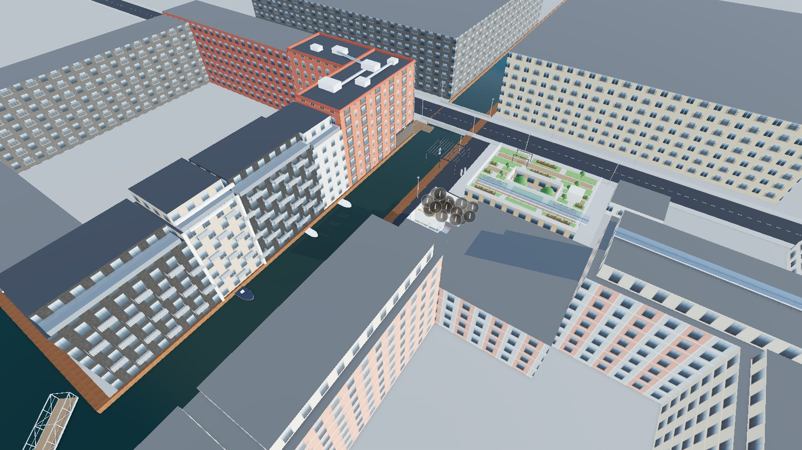

<FigureLabel>Sluseholmen, more or less. The canals are real. The boats are real. The windows are a lie.</FigureLabel>

So now I know exactly how far the gym is ([TK: real distance/minutes to SATS]). I know which windows face the canal. I know that from the kitchen I'll see the water, and from the balcony I'll see a building that looks like a Lego set designed by an accountant.

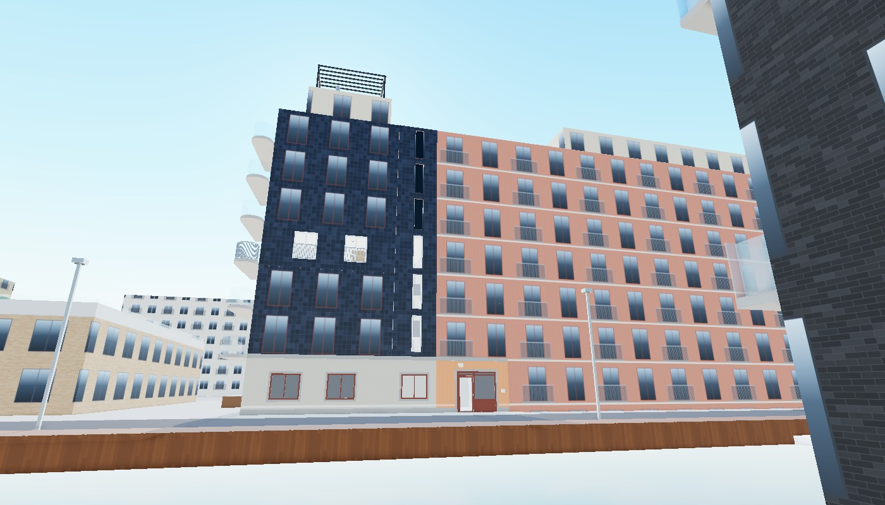

<FigureLabel>Our building from across the canal. Entrance no. 9 is where the pink starts.</FigureLabel>

## Completely unnecessary

That's when Claude asked me a question I was not prepared for.

<Dialogue>Now that the outside exists, should I build a working staircase and an elevator, so you can walk from the street up to the apartment?</Dialogue>

I thought about it for a long time. Two seconds.

<Dialogue>This is completely unnecessary. Please work on it.</Dialogue>

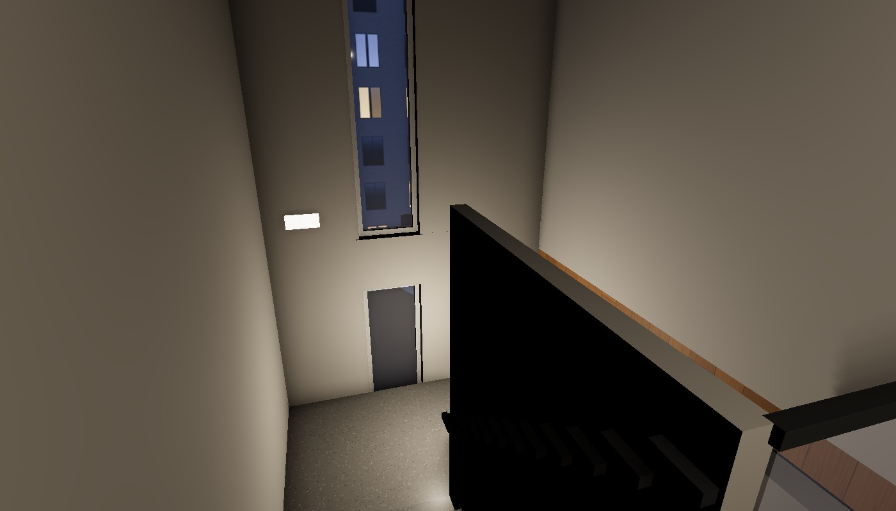

<FigureLabel>Motion-sensor lights in the stairwell. You can also take the lift. The lift has doors. The doors close. Nobody asked.</FigureLabel>

## Let there be light

The balcony faces east. Which means the morning sun comes straight into the living room, and I wanted to *see* that. Realistic light, realistic shadows, the full thing.

Claude delivered realistic light, all right. Danish light. Every single time I moved the time slider, the sky looked like a wet sock.

It took many, many iterations to explain that I didn't want an overcast sky. I wanted blue. Mediterranean blue. Sicilian August blue. The kind of sky Copenhagen sees maybe four days a year, and I wanted those four days on demand.

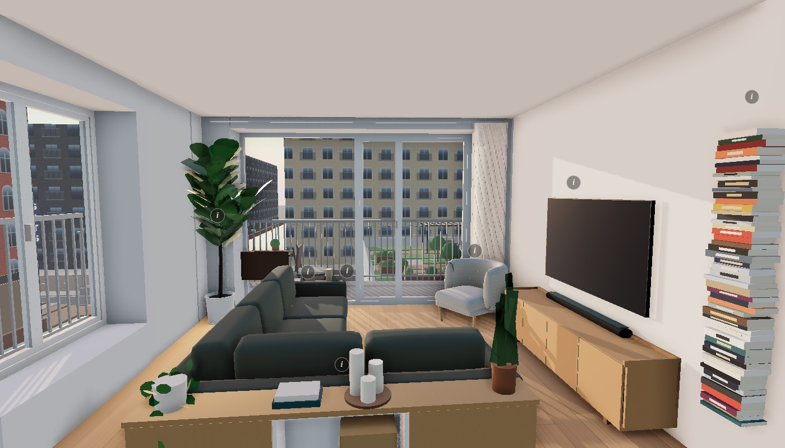

<FigureLabel>8:30 in the morning, Mediterranean edition. Copenhagen has filed a complaint.</FigureLabel>

Then, of course, I wanted a day-night cycle.

For the night sky, Claude first scattered some random white dots on a black background. And I said: don't be sloppy. I want the real Copenhagen night sky.

So now the stars are real. About a thousand of them, from an actual star catalogue, in the right positions for 55.7° North. If you stand on the balcony at midnight you can find the Big Dipper. In the model. Not in real life, in real life it's cloudy. {/* Fact check: ~1,000 stars brighter than magnitude 4.6 from the Yale Bright Star / Hipparcos data, via d3-celestial. Latitude of Copenhagen ≈ 55.7° N. */}

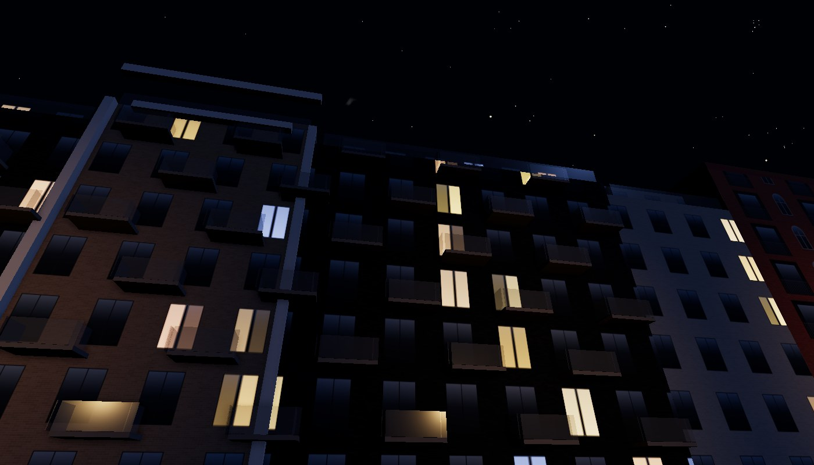

<FigureLabel>These are the actual stars. I checked. Well, Claude checked. I nodded.</FigureLabel>

Now that I, as God, had made night follow day (the opposite of the Bible, read your Genesis), I needed lights.

I set up a realistic configuration of Philips Hue lights and light strips. The pendant over the dining table, the strip behind the TV, the spots under the kitchen cabinets, the fairy lights on the balcony. All of it, to measure the one thing that matters in Denmark: the hygge level.

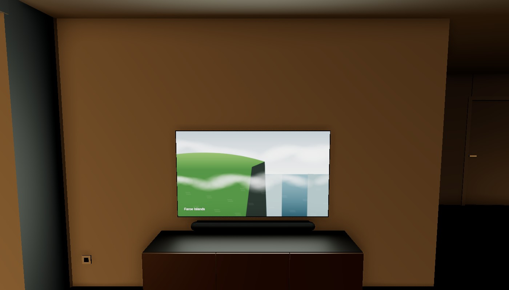

<FigureLabel>Yes, the TV turns on. It plays an aerial screensaver. No, nobody asked.</FigureLabel>

Each room has a light switch, and if you click it, a control panel opens. The first version was a classic developer interface: sliders, checkboxes, labels like `tvstrip_bri`. It looked like the cockpit of a Soviet submarine. I hated it.

So I asked for something more Apple-like. And the result is so nice that I'm thinking of turning it into a real app for my real house. {/* TK: true? The brief said "work in progress". */}

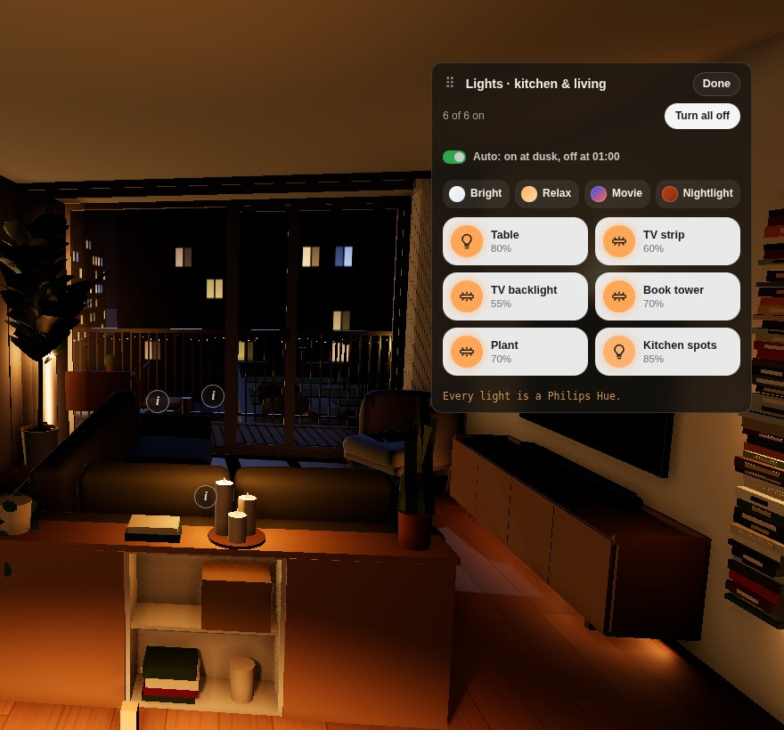

<FigureLabel>Bright, Relax, Movie, Nightlight. Four scenes, zero Soviet submarines.</FigureLabel>

## The rabbit hole

I won't set foot in the apartment until January. I want the whole experience nailed before then, so I keep going back to the render. A new lamp here. A different chair there. What if the plant was 20 cm to the left.

The funny thing is, it's not even expensive. All of this barely dented my weekly Claude allowance. {/* TK: rough %, if you want a number. Numbers are funnier. */}

The bottleneck is never the AI. The bottleneck is always us. My girlfriend and me, deciding what's next, changing our minds, changing them back. And Claude just waits. It accepts our indecision. It takes the third reversal on the same sofa with the patience of a saint.

And every time we contradict ourselves, it tells us how absolutely right we are.

<Pony>You're absolutely right! The sofa you hated yesterday is perfect! 🦄</Pony>

{/* Optional sincere beat, 2–3 lines max, if you want one: something about moving in together, building the home before living in it. Your call. */}

## What's next

Everyone I show this to is impressed. Then, jokingly, they ask what's next. Are you going to render the rest of the neighbourhood? The rest of Copenhagen?

Joke's on them.

I'm not planning a horizontal expansion. I'm planning a vertical one.

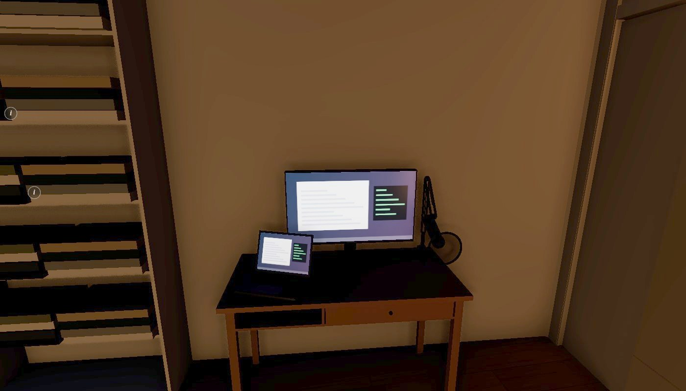

<FigureLabel>The small room. A desk. A laptop. You see where this is going.</FigureLabel>

In the small room there's a desk. On the desk there's a laptop. The laptop opens this blog. The blog opens the apartment. The apartment has a small room, with a desk, with a laptop. The laptop opens this blog. The blog opens the apartment. The apartment has a small room...

It's turtles all the way down. 🐢

<Spoiler>No, it doesn't work yet. Yes, I already asked.</Spoiler>

{/* Alternative endings:
  1) Post credits: "Oh, you are still here. She just opened the link. 'I hate this.'"
  2) End on the turtles, no spoiler.
*/}
